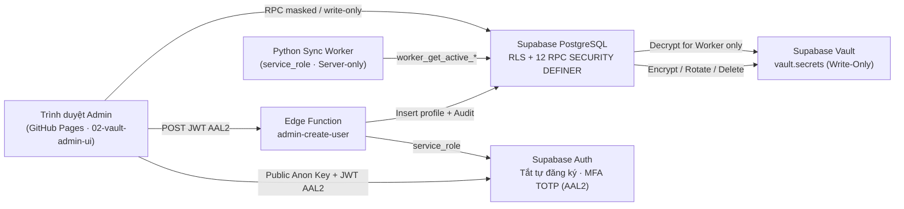

# J&T Express KPI-DPGS — Kho Bảo Mật Tài Khoản & Bí Mật Tập Trung (Admin AAL2)

Hệ thống quản trị bảo mật tách biệt hoàn toàn khỏi Dashboard vận hành, chạy **Web Frontend trên GitHub Pages** và **lưu trữ dữ liệu mã hóa trên Cloud Server (Supabase Cloud · PostgreSQL + Supabase Vault + Edge Functions)**.

- **Trang chủ GitHub Pages:** https://gust-belse.github.io/jt-vault-admin-web/
- **Cổng Kho Bảo Mật Admin (AAL2):** https://gust-belse.github.io/jt-vault-admin-web/02-vault-admin-ui/vault.html

---

## 1. Kiến trúc hệ thống & Bảo mật 4 tầng



### 4 lớp bảo vệ bắt buộc (Frontend + PostgreSQL)
1. **Không tự đăng ký công khai:** Mọi tài khoản `regional`, `hq`, `admin` đều do Admin AAL2 cấp trực tiếp qua Edge Function `admin-create-user` và bị ép đổi mật khẩu mạnh (`>= 12` ký tự gồm hoa, thường, số, ký tự đặc biệt) ngay lần đăng nhập đầu tiên.
2. **Cưỡng chế quyền Admin + MFA (AAL2) trong PostgreSQL:** Hàm `private.assert_admin_aal2()` kiểm tra đồng thời `auth.uid()`, `is_active = true`, `must_change_password = false`, `roles.code = 'admin'` và `auth.jwt() ->> 'aal' = 'aal2'`. Mọi tài khoản `regional`, `hq` hoặc chưa xác thực OTP đều bị chặn `42501`.
3. **Write-Only Vault:** Toàn bộ `JMS authToken`, `Feishu OAuth (access + refresh)` và cặp `Username / Password JMS` được mã hóa lưu tại `vault.secrets`. Bảng `vault_tokens`, `jms_credentials`, `security_audit_logs` khóa cứng Deny-All ở cấp RLS/Privilege; trình duyệt chỉ nhận chuỗi đã che (`masked_preview`).
4. **Nhật ký bảo mật bất biến (Append-Only):** Bảng `security_audit_logs` gắn trigger chặn mọi lệnh `UPDATE` và `DELETE` (`42501`), không bao giờ lưu giá trị bí mật gốc.

---

## 2. Cấu trúc thư mục

```text
jt-vault-admin-web/
├── index.html                                          # Trang chủ GitHub Pages + kiểm tra kết nối Cloud
├── 01-supabase-db/                                     # Backend Database Cloud (Supabase PostgreSQL)
│   ├── 001_schema_and_seed.sql                         # 7 bảng + Seed 3 vai trò & 7 khu vực J&T VN
│   ├── 002_rls_and_security_helpers.sql                # RLS Deny-All, Audit bất biến, Guard Admin AAL2
│   ├── 003_vault_rpc_functions.sql                     # 12 hàm RPC cho 4 tab Kho Bảo Mật
│   ├── 004_bootstrap_first_admin.sql                   # Hàm cấp Super Admin đầu tiên
│   ├── 005_worker_service_role_rpcs.sql                # RPC giải mã riêng cho Python Sync Worker
│   └── full_deploy_supabase_sql_editor.sql             # Tệp gộp 1-click chạy trên Supabase SQL Editor
├── 02-vault-admin-ui/                                  # Giao diện Kho Bảo Mật Admin (4 Tab)
│   ├── vault.html
│   └── js/
│       ├── config.js
│       ├── auth-guard.js
│       ├── vault-api.js
│       ├── ui-users.js
│       ├── ui-tokens.js
│       ├── ui-jms-creds.js
│       ├── ui-audit.js
│       └── vault-app.js
├── supabase/                                           # Chuẩn Supabase CLI
│   ├── config.toml                                     # Tắt signup, mật khẩu >= 12 ký tự, bật TOTP MFA
│   ├── migrations/20261125000001_init_vault_backend.sql
│   └── functions/admin-create-user/index.ts            # Edge Function cấp tài khoản nội bộ
├── 04-cloud-deploy/
│   ├── deploy-supabase.sh                              # Script đẩy tự động bằng Supabase CLI
│   └── .env.example
└── 05-sandbox-pipeline/                                # Kiểm thử tự động 4 tầng (Docker + Python)
    ├── docker-compose.test.yml
    ├── sql/000_sandbox_supabase_shim.sql
    └── run_executor_and_integration.py
```

---

## 3. Hướng dẫn triển khai Cloud Server (Supabase Cloud)

### Bước 1 — Tạo Supabase Cloud Project
1. Truy cập [Supabase Dashboard](https://supabase.com/dashboard) và tạo 1 project mới (chọn Region gần Việt Nam như **Singapore `ap-southeast-1`**).
2. Vào **Authentication → Providers → Email** và **TẮT** mục `Allow new users to sign up` (đóng tự đăng ký công khai).
3. Vào **Authentication → Multi-Factor** đảm bảo **TOTP (App Authenticator)** đang bật.

### Bước 2 — Khởi tạo Database (Chọn 1 trong 2 cách)

**Cách A — Nhanh nhất (Không cần cài CLI):**
1. Vào **Supabase Dashboard → SQL Editor → New Query**.
2. Dán toàn bộ nội dung tệp [`01-supabase-db/full_deploy_supabase_sql_editor.sql`](01-supabase-db/full_deploy_supabase_sql_editor.sql) và bấm **Run**.

**Cách B — Qua Supabase CLI (đẩy cả Database + Edge Function):**
```bash
supabase login
bash 04-cloud-deploy/deploy-supabase.sh <YOUR_PROJECT_REF>
```

### Bước 3 — Triển khai Edge Function `admin-create-user`
Nếu dùng Cách A ở Bước 2, triển khai thêm Edge Function bằng Supabase CLI:
```bash
supabase link --project-ref <YOUR_PROJECT_REF>
supabase functions deploy admin-create-user
```
> **Lưu ý:** Nếu dùng Gemini API Key cho các tác vụ AI sau này, lưu riêng tại Edge Function Secrets:
> `supabase secrets set GEMINI_API_KEY="YOUR_KEY"`

### Bước 4 — Khởi tạo tài khoản Super Admin đầu tiên
1. Vào **Supabase Dashboard → Authentication → Users → Add user → Create new user**.
2. Nhập email quản trị (ví dụ `admin@jtexpress.vn`), đặt mật khẩu mạnh (`>= 12` ký tự gồm hoa, thường, số, ký tự đặc biệt) và tick **Auto Confirm User**.
3. Mở **SQL Editor** và chạy lệnh sau:
```sql
SELECT private.bootstrap_first_admin(
  'admin@jtexpress.vn',
  'Quản Trị Viên Hệ Thống',
  false
);
```

### Bước 5 — Kết nối trang web GitHub Pages tới Supabase Cloud
Lấy **Project URL** và **anon public key** tại **Supabase Dashboard → Project Settings → API** (tuyệt đối **KHÔNG** dùng `service_role` key cho frontend!):

- **Cách 1 (Khuyên dùng cho vận hành cố định):** Cập nhật `url` và `anonKey` trong [`02-vault-admin-ui/js/config.js`](02-vault-admin-ui/js/config.js) rồi commit & push lên nhánh `main`.
- **Cách 2 (Kết nối nhanh trực tiếp trên trình duyệt):** Mở https://gust-belse.github.io/jt-vault-admin-web/02-vault-admin-ui/vault.html và dán `Project URL` + `anon public key` vào biểu mẫu kết nối nhanh (hệ thống tự chặn nếu dán nhầm `service_role` key).

Lần đăng nhập đầu tiên của Admin sẽ tự động hiện mã QR **Google Authenticator / Authy** để kích hoạt MFA (AAL2).

---

## 4. Tích hợp Python Sync Worker (Server-Side `service_role`)

Các hàm giải mã chỉ mở quyền cho `service_role` trên máy chủ Sync Worker:
- `worker_get_active_tokens(p_token_type, p_region_code)` — lấy `decrypted_token`, `decrypted_refresh_token` ưu tiên theo khu vực & `priority`
- `worker_get_active_jms_credentials(p_region_code)` — lấy `decrypted_username`, `decrypted_password` để tự động đăng nhập lại JMS khi token hết hạn
- `worker_report_token_status(p_token_id, p_status, p_last_error)` — báo trạng thái `active` / `expired` / `disabled`
- `worker_report_jms_login_result(p_cred_id, p_success, p_last_error)` — cập nhật thời điểm đăng nhập thành công gần nhất hoặc thông báo lỗi

---

## 5. Kiểm thử tích hợp & bảo mật tự động (Docker + Python)

Chạy bộ kiểm thử 4 giai đoạn (`db` → `security` → `edge` → `ui`) trên PostgreSQL 16 sandbox:

```bash
docker compose -f 05-sandbox-pipeline/docker-compose.test.yml up -d
python3 05-sandbox-pipeline/run_executor_and_integration.py --stage all
```

Dọn dẹp sau khi kiểm thử:
```bash
docker compose -f 05-sandbox-pipeline/docker-compose.test.yml down -v
```